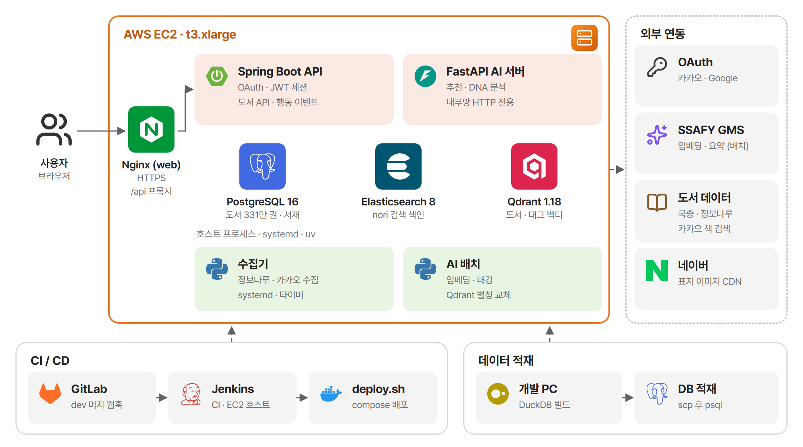
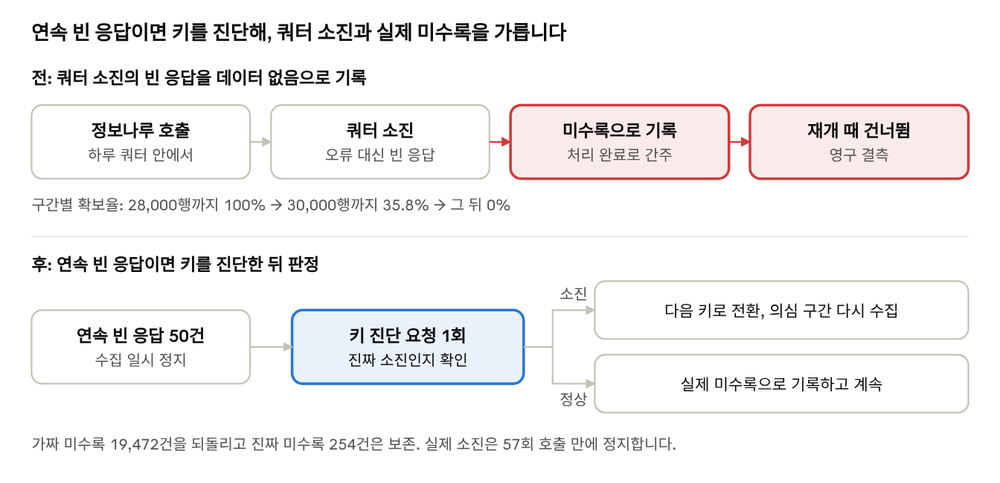
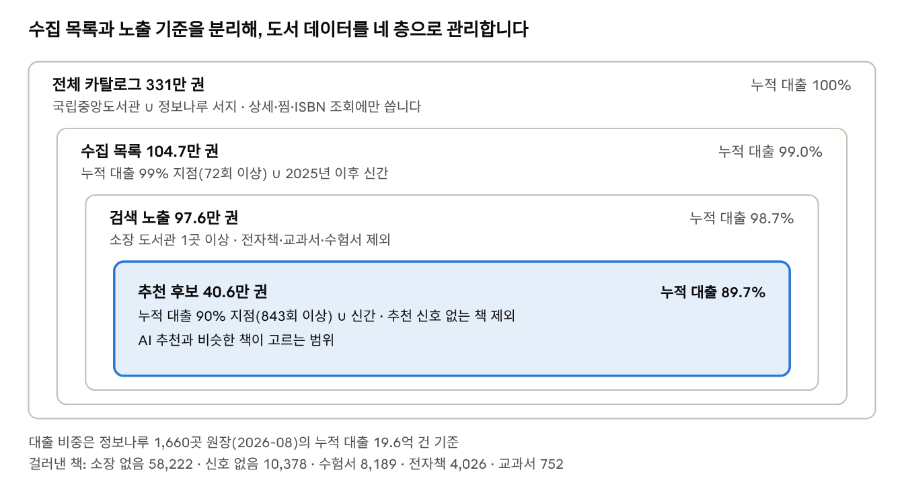
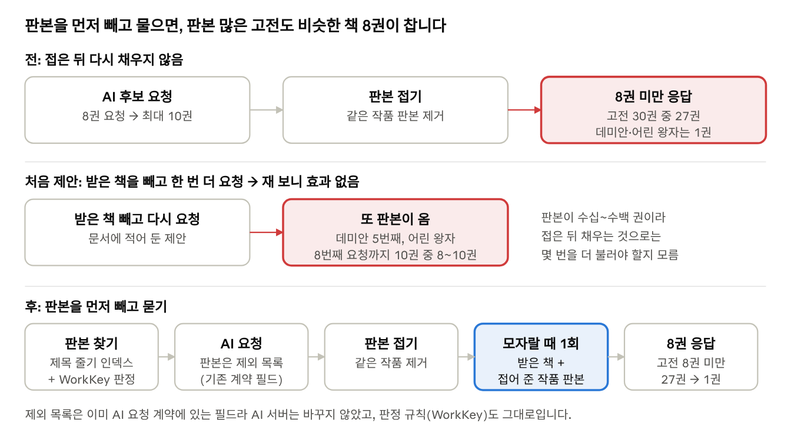

# 책추책책추

> 읽은 책을 기록하고, 도서관 대출 데이터로 다음에 읽을 책을 추천 이유와 함께 찾아 주는 개인 서재·도서 추천 서비스

  

  <a href="서비스개요.md">서비스 개요 (기능별 시연)</a> · <a href="docs/개선_상세.md">개선 상세 (측정 근거)</a>

## 프로젝트 개요

<table>
<thead>
<tr><th nowrap>항목</th><th nowrap>내용</th></tr>
</thead>
<tbody>
<tr><td nowrap>기간</td><td>2026.08.10 ~ 2026.09.28 (6주)</td></tr>
<tr><td nowrap>팀</td><td>6명 (백엔드 2, AI 1, 프론트 3)</td></tr>
<tr><td nowrap>담당</td><td>도서 데이터 수집·적재 파이프라인, 인증·도서 API, DB 스키마</td></tr>
<tr><td nowrap>데이터</td><td>도서 331만 권, 이 중 검색 노출 97.6만 권, 추천 후보 40.6만 권</td></tr>
<tr><td nowrap>기술</td><td>Java 21, Spring Boot 3.5, PostgreSQL 16, Elasticsearch 8(nori), Qdrant, Flyway, Python, DuckDB, Docker, Jenkins</td></tr>
</tbody>
</table>

## 내가 한 일

- **도서 데이터 수집**: 전국 공공도서관의 장서·대출 통계를 제공하는 도서관 정보나루, 카카오 책 검색, 국립중앙도서관 API에서 도서 정보를 모으는 수집기. API마다 하루 호출 한도가 있어 키별 예산과 장애를 구분했고, 109만 건을 사람 손 없이 끝까지 수집
- **적재 파이프라인과 데이터 정책**: 모은 데이터를 DuckDB로 정제해 PostgreSQL에 적재하고, 도서 331만 권 중 검색에 보여 줄 책과 추천에 쓸 책의 기준을 설계
- **인증·세션**: 카카오·Google 로그인, 짧은 액세스 토큰과 리프레시 토큰 회전으로 로그인 유지
- **도서 API와 스키마**: 인기·상세·함께 대출된 책·비슷한 책 API, Flyway 스키마 13개 중 10개, ERD와 API 명세

## 전체 아키텍처

- **EC2 한 대**: Nginx(web)·Spring Boot 백엔드·FastAPI AI 서버와 PostgreSQL·Elasticsearch·Qdrant를 Docker Compose로 운영
- **백엔드**: PostgreSQL·Elasticsearch 직접 사용, 추천은 내부망 AI 서버를 HTTP로 호출
- **AI 서버**: Qdrant 벡터 검색으로 추천 후보 선정
- **호스트 프로세스**: 수집기(systemd)와 임베딩·태깅 배치(uv)는 컨테이너 밖에서 실행
- **데이터 적재**: 개발 PC에서 DuckDB로 빌드한 도서 데이터를 EC2의 PostgreSQL에 적재
- **CI/CD**: GitLab 웹훅 → Jenkins → deploy.sh
- **내 담당**: 백엔드 API, PostgreSQL 스키마, 수집기와 적재 파이프라인

## 핵심 성과

<table>
<thead>
<tr><th nowrap>개선</th><th nowrap>지표</th><th nowrap>전</th><th nowrap>후</th></tr>
</thead>
<tbody>
<tr><td nowrap>호출 한도 소진 감지</td><td>"데이터 없음"으로 잘못 기록된 도서</td><td nowrap>19,472건 영구 누락</td><td nowrap>다시 수집 대상으로 복구</td></tr>
<tr><td nowrap>노출 정책 분리</td><td>소장 도서관이 한 곳도 없는 책의 검색 노출</td><td nowrap>노출됨</td><td nowrap>제외 (58,222권)</td></tr>
<tr><td nowrap>판본 묶기</td><td>비슷한 책에서 데미안 94권이 차지하는 묶음</td><td nowrap>24묶음</td><td nowrap>5묶음</td></tr>
<tr><td nowrap>세션 갱신</td><td nowrap>로그인 유지</td><td nowrap>15분마다 로그아웃</td><td nowrap>최대 14일</td></tr>
<tr><td nowrap>비슷한 책 판본 제외 (프로젝트 후)</td><td>판본 많은 고전 30권 중 8권 미만으로 보이는 책</td><td nowrap>27권</td><td nowrap>1권</td></tr>
</tbody>
</table>

수집 로그와 저장소 기록에 남은 값이고, 비슷한 책은 프로젝트가 끝난 뒤 운영 데이터 백업(도서 331만 권, 벡터 44만 건)으로 쟀습니다.

## 문제 해결

### 1. 하루 호출 한도를 넘긴 빈 응답이 "데이터 없음"으로 저장된 문제

- **상황**: 도서 소개와 키워드를 채우려고 도서관 정보나루 API에서 109만 권을 며칠에 걸쳐 수집했습니다. 정보나루는 API 키마다 하루 호출 한도(쿼터)가 있습니다.
- **문제**: 한도를 넘기면 오류 대신 빈 응답이 왔고, 수집기는 이를 "정보 없음(미수록)"으로 기록한 뒤 다시 수집하지 않았습니다. 호출 구간별로 보니 28,000번째 이후 확보율이 0%였습니다.
- **해결**: 연속으로 비어 있는 구간을 미처리로 되돌리는 복구 스크립트를 만들고, 수집기는 50건 연속으로 비면 멈추게 했습니다. 원래 미수록이 많은 신간에서 정상 키까지 멈추자, 키를 빼기 전에 진단 요청으로 한 번 더 확인하게 바꿨습니다.
- **결과**: 가짜 누락 19,472건 복구(진짜 미수록 254건은 유지), 실제 한도 소진 시 57번째 호출에서 정지

[자세히 보기](docs/개선_상세.md#1-하루-호출-한도를-넘긴-빈-응답이-데이터-없음으로-저장된-문제)

### 2. 수집 대상 목록을 그대로 검색·추천 기준으로 쓰던 설계 오류

- **상황**: 도서 331만 권 중 검색에 보여 줄 책과 추천에 쓸 책을 정해야 했습니다. 기준 데이터는 전국 공공도서관 1,660곳의 책별 누적 대출 기록(약 10년, 19.6억 건)입니다.
- **문제**: 소장 도서관이 한 곳도 없는 자비출판물이 검색과 추천에 나왔습니다. 정보를 채울 "수집 대상" 목록을 그대로 노출 기준으로 썼기 때문입니다.
- **해결**: 수집 목록, 검색 노출, 추천 후보를 따로 정의하고 DB 제약으로 고정했습니다. 기준은 책 권수가 아니라 "전체 대출의 몇 %를 덮는가"로 정해, 수집은 대출의 99%, 추천은 책 정보가 충분한 90% 구간까지 담았습니다.
- **결과**: 검색 노출 97.6만 권(전체 대출의 98.7%), 추천 후보 40.6만 권(89.7%), 빌릴 수 없는 책 58,222권 제외

[자세히 보기](docs/개선_상세.md#4-수집-대상-목록을-그대로-검색추천-기준으로-쓰던-설계-오류)

### 3. 판본 많은 고전의 「비슷한 책」이 1권만 보이던 문제

- **상황**: 「비슷한 책」은 AI가 고른 비슷한 책 10권을 받은 뒤, 같은 작품의 다른 판본(출판사나 번역본만 다른 같은 책)을 하나로 묶어 보여 줍니다.
- **문제**: 프로젝트가 끝난 뒤 운영 데이터로 재 보니, 판본이 많은 고전 30권 중 27권이 8권 미만으로 보였고 데미안은 1권만 보였습니다. AI가 고른 10권 대부분이 같은 책의 다른 판본이었습니다.
- **해결**: 처음 생각한 "받은 책을 빼고 다시 요청"은 데미안은 다섯 번째, 어린 왕자는 여덟 번째 요청까지 판본이 계속 나와 효과가 없었습니다. 그래서 AI를 부르기 전에 같은 작품의 판본을 먼저 찾아 제외 목록으로 넘기게 바꿨습니다.
- **결과**: 고전 30권 중 8권 미만 27권 → 1권, 대출 상위 500권 중 24권 → 1권, AI 서버 API는 그대로

[자세히 보기](docs/개선_상세.md#7-판본-많은-고전의-비슷한-책이-1권만-보이던-문제)

<b>그 밖의 문제 해결 (4건)</b>

- **101만 건 병렬 수집에서 메모리가 2.1GB까지 오르던 문제**: 작업을 2만 건씩 나눠 넣고, 완료 판정은 ISBN만 읽어 2.6배 빠르게
- **같은 작품의 판본은 묶고 시리즈의 다른 권은 남기기**: 데미안 24묶음 → 5묶음, 셜록 홈즈 같은 시리즈는 권별로 유지
- **태그 대량 갱신이 온라인 검색을 멈춘 문제**: 바뀐 8.5만 건만 나눠 갱신해 검색이 느려지지 않게 하고, 태그 필터 인덱스를 추가해 필터 조회 11~20초 → 4초
- **15분마다 로그아웃되던 문제**: 리프레시 토큰 회전과 재사용 감지, 여러 탭의 동시 갱신은 정상으로 처리

[전체 기록 보기](docs/개선_상세.md)

## 기술 선택 이유

<table>
<thead>
<tr><th nowrap>선택</th><th nowrap>이유</th></tr>
</thead>
<tbody>
<tr><td nowrap>Elasticsearch + nori</td><td>띄어쓰기 없이 "총균쇠"로 검색해도 「총 균 쇠」를 찾도록 한국어 형태소 분석이 필요해서</td></tr>
<tr><td nowrap>PostgreSQL 부분 인덱스·CHECK 제약</td><td>331만 권 중 검색·추천 대상만 빠르게 고르고, 데이터 정책을 DB 수준에서 지키려고</td></tr>
<tr><td nowrap>DuckDB</td><td>수백만 행의 원천 파일을 DB에 넣기 전에 PC에서 바로 정제하고 합치려고</td></tr>
<tr><td nowrap>systemd로 수집기 운영</td><td>며칠씩 걸리는 수집을 서버에서 무인으로 돌리고, 메모리 상한(3GB)으로 다른 서비스를 보호하려고</td></tr>
<tr><td nowrap>리프레시 토큰 계열 단위 관리</td><td>여러 탭의 동시 갱신은 허용하고, 탈취된 토큰이 다시 쓰이면 계열 전체를 폐기하려고</td></tr>
</tbody>
</table>

## 검토와 제안

**추천 화면의 행동 이벤트를 한 번에 묶어 보내는 방안을 측정했지만, 지금은 적용하지 않았습니다.** 묶으면 화면당 서버 시간이 30.6ms에서 약 8.5ms(추정)로 줄지만, 사용자가 기다리지 않는 요청이라 체감 차이가 없고 API와 화면을 함께 바꿔야 합니다. 대신 계약을 바꾸지 않고 SQL을 하나로 합치는 방법을 먼저 제안했습니다.

[검토 전체 보기](docs/개선_상세.md#행동-이벤트를-한-건씩-보내는-문제-측정-완료-미적용)
