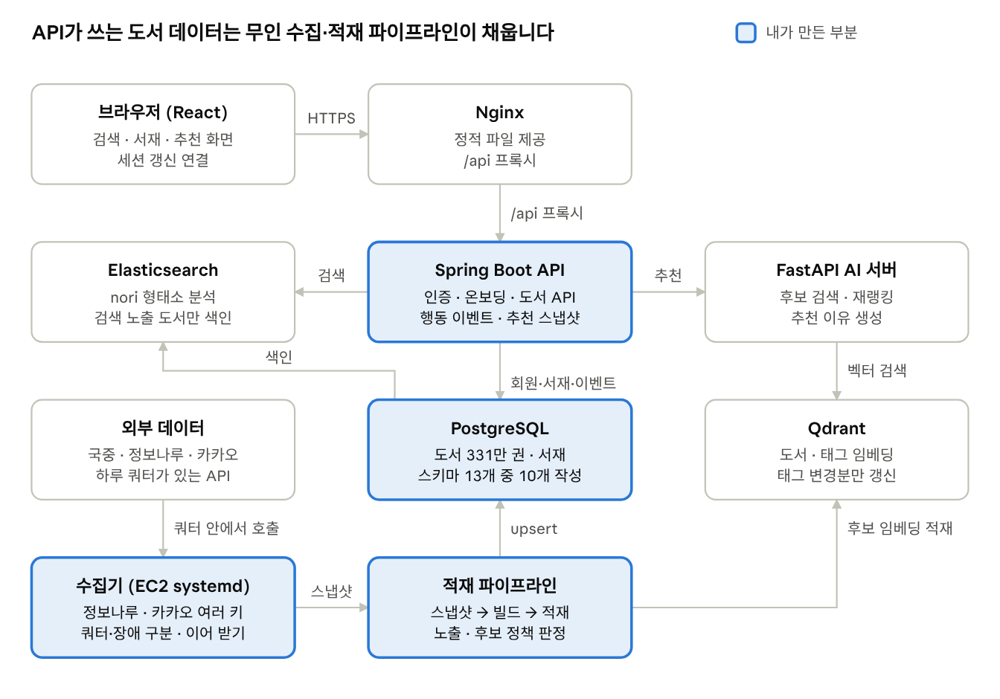
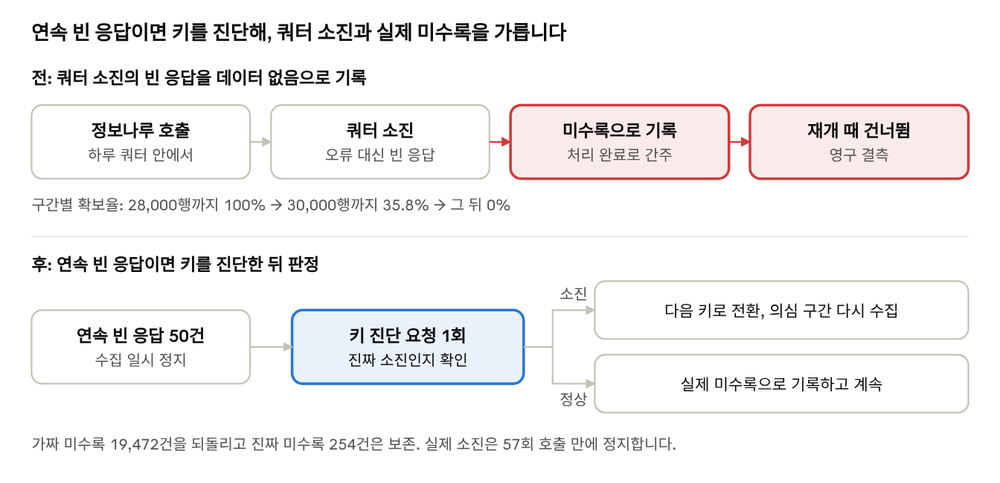
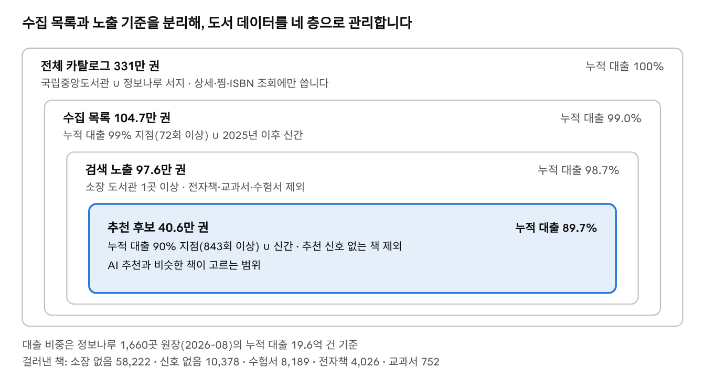
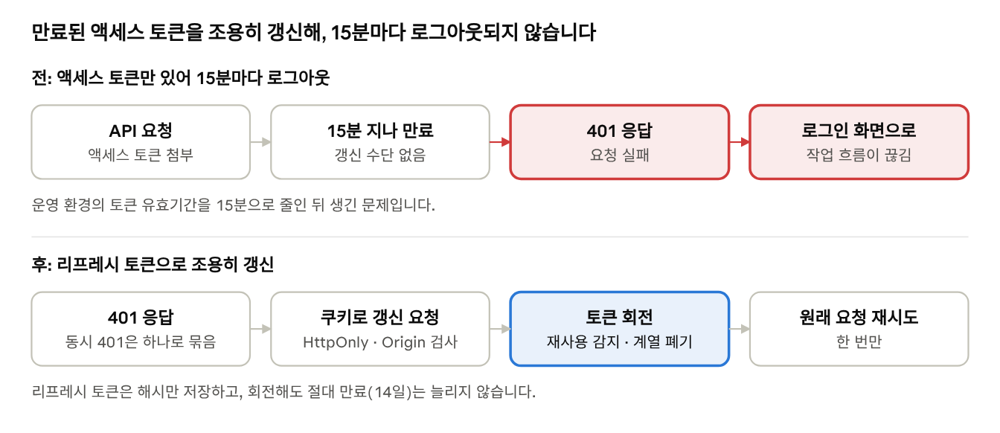
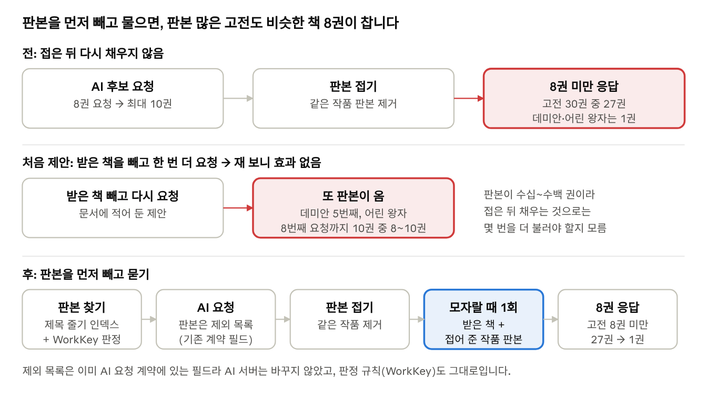

# 책추책책추 개선 상세

[← README로 돌아가기](../README.md)

README에 요약한 문제 해결을 측정 조건과 판단 근거까지 담아 정리한 문서입니다.

## 서비스 구조

사용자 요청은 Spring Boot API가 받아 PostgreSQL, Elasticsearch, AI 서버를 호출합니다. 그 뒤에서는 수집기가 하루 호출 한도 안에서 외부 데이터를 모으고, 적재 파이프라인이 데이터를 정제한 뒤 검색 노출과 추천 후보 여부를 판정해 DB와 벡터 DB에 넣습니다.

### 주요 구현

<table>
<thead>
<tr><th nowrap>영역</th><th nowrap>내용</th></tr>
</thead>
<tbody>
<tr><td nowrap>대규모 수집기</td><td>API 키마다 하루 29,000회 예산, 게이트웨이 오류(502·503·504)와 쿼터 소진 구분, 전체 정지 스위치, 키별 사용량 저장과 백오프. 정보나루 대상 109만 건을 사람 손 없이 끝까지 수집</td></tr>
<tr><td nowrap>서비스 DB 적재</td><td>파일을 바로 SQL로 다루는 DuckDB로 빌드하면서 ISBN 체크섬 검증(10만 건 제외), 저자 표기에서 역할어 제거, 소개문이 없을 때 쓸 출처 순서 지정. <code>\copy</code> upsert로 로컬과 EC2를 같은 스크립트로 적재</td></tr>
<tr><td nowrap>데이터 층</td><td>데이터 층, 검색 노출, 추천 후보를 따로 관리하고 CHECK 제약과 부분 인덱스로 고정. 후보 빌드 2분 30초</td></tr>
<tr><td nowrap>인증·세션</td><td>카카오·Google OAuth, JWT 발급자 검증, state 값 상수 시간 비교, 리프레시 토큰 회전과 재사용 감지, 만료 토큰 매일 정리</td></tr>
<tr><td nowrap>도서 API</td><td>인기·연령대별 인기, 상세, 함께 대출된 책, 비슷한 책(AI 프록시와 판본 묶기), 부분 인덱스</td></tr>
<tr><td nowrap>행동 이벤트</td><td>항상 202로 응답, 클라이언트 이벤트 ID로 중복 무시, 추천 스냅샷은 별도 트랜잭션, 테스트 22개</td></tr>
</tbody>
</table>

## 문제 해결과 개선

수집은 수십만 건을 며칠씩 사람 손 없이 돌리는 작업이라, 작은 판단 착오 하나가 대량 결측이나 수집 중단으로 이어졌습니다. 구간별 확보율이나 프로세스 메모리처럼 눈에 보이는 지표로 원인을 좁혔고, 고친 뒤에는 같은 데이터로 다시 확인했습니다. 수치는 수집 로그와 저장소 문서에 남은 값입니다. 4절의 대출 비중, 7절, 개선 검토의 수치만 프로젝트가 끝난 뒤 운영 덤프(도서 331만 권, 벡터 44만 건)로 쟀습니다.

<table>
<thead>
<tr><th nowrap>개선</th><th nowrap>지표</th><th nowrap>전</th><th nowrap>후</th></tr>
</thead>
<tbody>
<tr><td nowrap>쿼터 소진 감지</td><td>미수록으로 잘못 기록된 데이터</td><td nowrap>19,472건 영구 결측</td><td nowrap>재수집 대상으로 복구</td></tr>
<tr><td nowrap>같은 개선</td><td nowrap>실제 소진 시 멈추기까지</td><td nowrap>감지 못 함</td><td nowrap>57회 호출</td></tr>
<tr><td nowrap>수집기 메모리</td><td>완료 판정 (실제 64,376건)</td><td nowrap>레코드 전체 JSON 파싱</td><td nowrap>ISBN 필드만 읽기, 결과는 같고 2.6배 빠름</td></tr>
<tr><td nowrap>판본 묶기</td><td>데미안 94권이 보이는 묶음</td><td nowrap>24묶음</td><td nowrap>5묶음</td></tr>
<tr><td nowrap>노출 정책 분리</td><td>소장 도서관 0곳인 책의 검색 노출</td><td nowrap>노출됨</td><td nowrap>제외 (58,222권)</td></tr>
<tr><td nowrap>태그 필터 인덱스</td><td nowrap>태그 필터 조회</td><td nowrap>11~20초</td><td nowrap>4초</td></tr>
<tr><td nowrap>세션 갱신</td><td nowrap>로그인 유지</td><td nowrap>15분마다 로그아웃</td><td nowrap>토큰 회전으로 최대 14일</td></tr>
<tr><td nowrap>비슷한 책 판본 제외 (프로젝트 후)</td><td>판본 많은 고전 30권 중 8권 미만</td><td nowrap>27권 (평균 3.8권)</td><td nowrap>1권 (평균 7.9권)</td></tr>
<tr><td nowrap>같은 개선</td><td>대출 상위 500권 중 8권 미만</td><td nowrap>24권</td><td nowrap>1권</td></tr>
</tbody>
</table>

### 1. 하루 호출 한도를 넘긴 빈 응답이 "데이터 없음"으로 저장된 문제

도서 소개와 키워드를 채우려고 정보나루 API로 109만 권을 며칠에 걸쳐 수집했습니다. 정보나루는 API 키마다 하루 호출 한도(쿼터)가 있는데, 한도를 넘기면 오류 대신 빈 응답을 돌려줍니다. 수집기는 이 빈 응답을 "미수록"으로 기록했고, 재개 로직은 미수록도 처리가 끝난 것으로 보고 다시 수집하지 않았습니다. 누적 확보율만 보고 있어서 발견도 늦었습니다. 호출 구간별로 나눠 보니 0~28,000행은 100%, 28,000~30,000행은 35.8%, 그 뒤로는 0%였습니다.

50건 넘게 연속으로 빈 구간의 기록을 지워 미처리 상태로 되돌리는 복구 스크립트를 만들었고, 수집기는 50건 연속으로 비면 멈추고 의심 구간을 잘라 내게 했습니다. 그런데 신간은 원래 미수록 비율이 12.1%로 높아서, 정상 키까지 소진으로 판정하는 바람에 수집이 약 8시간 멈췄습니다. 그래서 키를 빼기 전에 진단 요청을 한 번 보내 정말 소진됐는지 확인하도록 바꿨습니다.

- 가짜 미수록 19,472건을 재수집 대상으로 되돌렸고, 진짜 미수록 254건은 그대로 두었습니다.
- 실제로 쿼터가 소진됐을 때는 57번째 호출에서 멈췄고, 그전까지 받은 파일은 그대로 유지했습니다.
- 정상 키에 빈 응답 120건을 흉내 내 보낸 시험에서는 120건을 모두 기록하고, 키는 하나도 멈추지 않았습니다.

### 2. 101만 건 병렬 수집에서 메모리가 2.1GB까지 오르던 문제

여러 서비스가 함께 쓰는 EC2(메모리 상한 3GB)에서 수집기를 시작하자마자 메모리가 2.1GB까지 올랐습니다. 원인은 세 가지였습니다. 수집 대상 109만 건 중 남은 101만 건을 스레드 풀에 한 번에 넘겨 대기 작업 객체가 모두 먼저 만들어졌고, 대기열을 중간 리스트 세 개로 복사해 들고 있었으며, 완료 여부를 판단할 때도 평균 3.4KB인 레코드 전체를 JSON으로 파싱하고 있었습니다.

작업은 2만 건씩 나눠 제출하고, 다 쓴 리스트는 바로 해제하고, 완료 판정은 레코드 맨 앞의 ISBN 필드만 읽도록 바꿨습니다. 실제 64,376건으로 확인해 보니 완료 판정 결과는 기존과 같으면서 2.6배 빨랐습니다.

### 3. 판본은 묶고, 시리즈의 다른 권은 남기기

「비슷한 책」 목록에 같은 작품의 다른 판본(출판사나 번역자만 다르게 낸 같은 책)이 반복해서 나왔습니다. 그렇다고 세트 ISBN을 기준으로 묶으면, 전집 한 세트에 든 14개 작품이 한 권으로 합쳐졌습니다. "제목 + 대표 저자 + 권차" 문자열 하나로 비교하는 방식으로는, 옮긴이가 저자 자리에 먼저 오거나, 시리즈의 몇 번째 권인지 적는 권차 칸에 출판사 문고 번호가 들어간 실제 서지를 처리할 수 없었습니다.

그래서 두 책을 직접 맞대어 비교하게 바꿨습니다. 제목에서 부제와 괄호를 뗀 핵심 부분(제목 줄기)과 저자 목록이 겹치는지 보고, 권차가 다를 때는 같은 출판사, 같은 세트이면서 카탈로그에 시리즈로 등록된 제목일 때만 다른 권으로 판단합니다. 정보가 부족하면 묶지 않고, 이 규칙은 회귀 테스트 17개로 고정했습니다.

| 작품 (후보 44만 권에서 측정) | 전 | 후 |
| --- | --- | --- |
| 데미안 94권 | 24묶음 | 5묶음 |
| 셜록 홈즈 | 9묶음 (권이 뭉개짐) | 17묶음 (권별로 유지) |
| 토지 · 먼나라 이웃나라 | — | 33 · 16묶음으로 시리즈 유지 |
| 어린 왕자 | 42묶음 | 53묶음 (덜 묶임) |

어린 왕자처럼 오히려 덜 묶이는 경우도 생겼지만, 시리즈를 잃는 것보다는 덜 묶이는 편이 낫다고 판단했습니다.

### 4. 수집 대상 목록을 그대로 검색·추천 기준으로 쓰던 설계 오류

소장 도서관이 한 곳도 없는 자비출판물이 검색과 추천에 나왔고, 같은 작품의 종이책과 전자책이 나란히 보였습니다. 원래 "수집 대상"으로 만든 목록을 그대로 노출 기준으로 쓴 것이 원인이었습니다. 데이터 층, 검색 노출, 추천 후보를 따로 관리하도록 나누고, CHECK 제약과 부분 인덱스로 규칙을 DB에 고정했습니다. 그 결과 검색 노출은 104.7만 권에서 97.6만 권으로, 추천 후보는 44.1만 권에서 40.6만 권으로 정리됐습니다. 추천 품질 수치가 아니라, 데이터 범위를 바로잡은 결과입니다.

**어떤 대출 데이터로, 어디까지 담았나**

기준은 정보나루 보유 원장입니다. 전국 공공도서관 1,660곳의 「도서관 × ISBN × 누적 대출 × 소장 권수」 데이터 1.21억 행을 표본이 아니라 전부 받았습니다. DB에 들어온 책 275만 권 기준으로 합치면 누적 대출은 19.6억 건입니다(2026년 8월 원장, 약 10년 누적).

누적 대출은 인기 순위에는 쓰지 않고, 어디까지 담을지 정하는 필터로만 썼습니다. 기준선도 대출 횟수가 아니라 "전체 누적 대출의 몇 %를 덮는가"로 정했습니다. 같은 "20회 이상"이라도 250곳을 합치면 대출의 99.2%를 덮지만, 1,660곳을 합치면 훨씬 느슨한 기준이 되기 때문입니다. 비율로 정해 두면 원장이 커져도 기준의 의미가 바뀌지 않습니다.

<table>
<thead>
<tr><th nowrap>집합</th><th nowrap>기준</th><th nowrap>권수</th><th nowrap>수집 목록 대비</th><th nowrap>누적 대출 비중</th></tr>
</thead>
<tbody>
<tr><td nowrap>수집 목록</td><td>누적 대출 99% 지점(72회 이상) ∪ 2025년 이후 신간</td><td nowrap>1,047,435</td><td nowrap>100%</td><td nowrap>99.0%</td></tr>
<tr><td nowrap>검색 노출</td><td>수집 목록 − 소장 0곳·전자책·교과서·수험서</td><td nowrap>976,246</td><td nowrap>93.2%</td><td nowrap>98.7%</td></tr>
<tr><td nowrap>추천 후보</td><td>누적 대출 90% 지점(843회 이상) ∪ 신간 − 위 제외 − 신호 없는 책</td><td nowrap>406,451</td><td nowrap>38.8%</td><td nowrap>89.7%</td></tr>
<tr><td nowrap>메타데이터만</td><td nowrap>수집 목록 밖 나머지</td><td nowrap>2,265,032</td><td nowrap>—</td><td nowrap>0.97%</td></tr>
</tbody>
</table>

권수는 도서 3,312,467권 기준이고, 누적 대출 비중은 프로젝트가 끝난 뒤 같은 DB 덤프로 다시 집계했습니다.

수집 목록은 넓게 잡았습니다. 잘못 넣은 책은 순위에서 밀려나면 그만이지만, 잘못 뺀 책은 검색에도 추천에도 영영 나오지 않기 때문입니다. "대출 1회 이상"으로 거르면 장서의 84.2%가 통과해 사실상 거르는 효과가 없었습니다. 250곳 표본으로 기준을 조금씩 올려 보니, 한 구간 올릴 때마다 잃는 대출이 0.23%p 이하로 완만하다가 어느 지점부터 0.45%p, 0.9%p, 1.1%p로 빠르게 커졌습니다. 99%는 그 완만한 구간 안에 있어서, 기준을 조금 옮겨도 덮는 비율이 거의 변하지 않습니다.

검색은 사용자가 이미 알고 있는 책을 찾는 기능이라 수집 목록에서 거의 줄이지 않았습니다. 빠진 7.1만 권(소장 0곳 5.8만 권 포함)은 누적 대출의 0.32%에 불과합니다. 소장 기준을 1곳으로 정한 근거는 신간의 소장 도서관 수별 대출 발생률입니다. 소장 0곳은 0%, 1곳은 26.1%, 2곳은 54.0%, 3~5곳은 74.6%, 6~10곳은 88.9%였습니다. 기준을 더 올리지 않은 것은 원장 전체에서 소장 도서관 수의 중앙값이 4곳, 상위 10% 경계가 114곳이기 때문입니다. 100곳 같은 기준을 쓰면 빌릴 수 있는 책 대부분이 빠집니다.

추천은 책 소개를 숫자 벡터로 바꾼 임베딩과, 같은 이용자들이 함께 빌린 책 정보(함께대출)가 있어야 쓸 수 있어서 더 좁게 잡았습니다. 누적 대출 커버리지 곡선과 집합별 정보 보유율을 함께 보고 90%에서 끊었습니다.

| 덮는 누적 대출 | 50% | 80% | 85% | **90%** | 95% | 99% |
| --- | --: | --: | --: | --: | --: | --: |
| 필요한 책 | 5.3만 | 20.9만 | 26.8만 | **35.7만** | 52.0만 | 94.1만 |
| 누적 대출 기준값 | 7,621회+ | 1,965회+ | 1,391회+ | **869회+** | 400회+ | 72회+ |

| 집합 | 권수 | 소개 100자 이상 | 표지 | 키워드 | 함께대출 |
| --- | --: | --: | --: | --: | --: |
| 추천 후보 | 40.6만 | 89.3% | 92.7% | 41.7% | 77.5% |
| 검색에만 있는 꼬리 | 55.9만 | 70.6% | 82.0% | 3.3% | 41.5% |
| 메타데이터만 | 226.5만 | 6.1% | 0% | 0% | 0% |

90%에서 99%로 넓히면 대출은 9%p 더 덮지만 책이 58만 권 늘어납니다. 늘어나는 책들은 키워드가 있는 비율이 3.3%, 함께대출 정보가 있는 비율이 41.5%라 추천 근거로 쓰기 어렵습니다. 반대로 85%로 줄이면 8.9만 권을 덜 담는 대신 대출 5%p를 잃습니다.

90%에서 끊은 뒤에도 함께대출 대상 연결의 99.1%, 정보나루 마니아·다독자 추천 목록의 97.4%와 98.9%가 후보 안에 남았고, 세그먼트별 인기 도서 1,200권도 모두 들어 있었습니다. 기준값 843회는 결정 당시 원장 전체 ISBN 279만 개로 계산해 고정한 값입니다. DB에 들어온 책만으로 곡선을 다시 그리면 869회로 거의 같습니다.

### 5. 태그 대량 갱신이 온라인 검색을 멈춘 문제

온보딩에서 고르는 장르 6개가 AI 태그 체계에 없어서, 이 장르를 고른 사용자는 일반 추천으로 빠지고 있었습니다. 그래서 임베딩을 다시 만들지 않고 태그만 바꾸는 경로를 만들었습니다. 그런데 첫 실행에서 44만 건을 쉬지 않고 갱신하자 벡터 검색 DB인 Qdrant의 메모리가 한도에 닿아, 온라인 검색이 0.13초에서 39초로 느려졌습니다.

바뀐 약 8.5만 건만 갱신하고, 배치 크기를 줄여 배치 사이에 쉬는 시간을 두었습니다. 같은 때 컬렉션에 필터용 인덱스가 하나도 없어, 태그 필터 조회가 44만 건을 전부 훑고 있다는 것도 찾았습니다. 태그 필터 인덱스를 만들자 이 조회가 11~20초에서 4초로 줄었고, 컬렉션을 만들 때 필터용 인덱스 4종을 자동으로 만들게 했습니다. 제가 만든 부분은 태그 갱신 스크립트와 테스트, 필터 인덱스 자동 생성입니다.

### 6. 15분마다 로그아웃되던 문제: 리프레시 토큰 회전

운영 환경에서 액세스 토큰 유효기간을 15분으로 줄이자, 토큰을 갱신할 방법이 없어 15분마다 로그아웃됐습니다. 리프레시 토큰은 한 번 로그인해서 이어지는 토큰 묶음(계열) 단위로 관리하고, DB에는 해시만 저장했습니다. 회전 후 10초 안에 이전 토큰이 다시 쓰이면 여러 탭이 동시에 갱신한 것으로 보고, 그 밖의 재사용은 탈취로 판단해 계열 전체를 폐기합니다.

화면에서는 동시에 받은 401을 갱신 요청 하나로 묶고, 원래 요청은 한 번만 다시 보냅니다. 시계를 주입한 단위 테스트 7개와 흐름 통합 테스트 5개로 확인했습니다.

### 7. 판본 많은 고전의 「비슷한 책」이 1권만 보이던 문제

「비슷한 책」은 AI가 벡터 검색으로 고른 비슷한 책 10권을 받은 뒤 같은 작품의 판본을 묶습니다. 프로젝트 때는 판본이 많은 고전에서 목록이 짧아질 수 있다는 것을 코드로만 짐작했습니다. 프로젝트가 끝난 뒤 운영 덤프(도서 331만 권, 벡터 44만 건)로 재 보니, 고전 30권 중 27권이 8권 미만으로 나왔고 데미안과 어린 왕자는 1권만 보였습니다.

처음 생각한 방법은 "받은 책을 빼고 한 번 더 요청하기"였는데, 실제로 해 보니 효과가 없었습니다. 데미안은 다섯 번째 요청까지, 어린 왕자는 여덟 번째 요청까지 10권 중 8~10권이 또 판본이었습니다. 그래서 순서를 바꿨습니다. AI를 부르기 전에 기준 책과 같은 작품인 판본을 카탈로그에서 먼저 찾아 제외 목록으로 넘기고(추천 후보 제목 줄기 인덱스, V13), 그래도 모자랄 때만 한 번 더 요청합니다.

| 기준 책 | 8권 미만 | 평균 표시 | 요청당 AI 호출 | 응답 p50 |
| --- | --: | --: | --: | --: |
| 대출 상위 500권 · 전 | 24권 (4.8%) | 7.89권 | 1.00 | 71ms |
| 대출 상위 500권 · 후 | 1권 (0.2%) | 8.00권 | 1.03 | 75ms |
| 판본 많은 고전 30권 · 전 | 27권 (90%) | 3.80권 | 1.00 | 75ms |
| 판본 많은 고전 30권 · 후 | 1권 (3.3%) | 7.93권 | 1.70 | 137ms |

판본을 먼저 빼도 고전의 40%는 여전히 모자랐습니다. 묶기 로그를 보니 기준 책(민음사 데미안)에 문고 번호가 있어서, 권차가 없는 다른 출판사 판본들은 "다른 작품"으로 남았고(같은 작품인지 판정하는 WorkKey의 보수적인 규칙), 그중 한 권 아래로 나머지 15권이 묶이고 있었습니다. 다시 요청할 때 이렇게 묶인 작품의 판본까지 빼자 8권 미만 비율이 3.3%로 줄었습니다. "잘못 묶기보다는 덜 묶기"라는 판정 규칙은 그대로 두었습니다.

대부분의 책은 응답이 4ms 정도 늘었고(SQL 몇 개), 고전은 두 번째 AI 호출 때문에 63ms 늘었습니다. 인덱스 크기는 17MB이고 만드는 데 60초 걸렸습니다. 제외 목록은 이미 AI 요청 계약에 있는 필드라 AI 서버 API는 바꾸지 않았습니다. 판본 제외, 재요청 제외 목록, 묶인 작품의 판본 제외는 단위 테스트 3개로 고정했고, 측정 테스트로 같은 데이터에서 전후를 비교했습니다.

측정은 운영 덤프(2026-09-28)를 복원한 PostgreSQL과 Qdrant, 로컬 AI 서비스로 했습니다. 기준 책은 누적 대출 상위 500권과 고전 30권(제목이 같은 판본 중 가장 많이 빌린 한 권)이고, 두 방식 모두 캐시가 데워진 같은 상태에서 실행했습니다.

## 개선 검토

### 행동 이벤트를 한 건씩 보내는 문제 (측정 완료, 미적용)

추천 화면을 한 번 열면 덱 노출 1건과 카드 노출 5건이 각각 따로 요청됩니다. 프로젝트가 끝난 뒤 운영 덤프를 복원한 DB에서 인증 필터부터 저장까지 실제 경로로 재 보니, 화면 한 번에 요청 6회, SQL 17회(설계 때 계산과 같음), 서버 시간 p50 30.6ms가 들었습니다.

| 방식 | 요청 | SQL | 화면당 서버 시간 p50 | p95 |
| --- | --: | --: | --: | --: |
| 지금 (이벤트마다 요청) | 6 | 17 | 30.6ms | 47.1ms |
| 묶음 (추정) | 1 | 3 | 8.5ms | 12.7ms |

묶어 보내면 화면당 서버 시간이 약 3.6배 줄고, SQL도 17회에서 3회로 줄어듭니다. 하지만 지금은 적용하지 않았습니다. 이벤트 요청은 화면이 기다리지 않는 요청(항상 202)이라 사용자가 느끼는 차이가 없고, 줄어드는 서버 시간도 화면 한 번에 22ms라 지금 트래픽에서는 작습니다. 반면 적용하려면 API 계약과 화면 코드를 함께 바꿔야 하고, 화면에 모아 두었다가 보내는 동안 탭을 닫으면 이벤트가 사라지는 경우도 따로 막아야 합니다.

계약을 바꾸지 않고 먼저 할 수 있는 방법도 있습니다. 이벤트 한 건에서 실행되는 SQL(책 확인, 덱 조회, 저장)을 INSERT ... SELECT 한 문장으로 합치면, 화면당 SQL을 17회에서 6회로 줄일 수 있습니다.

측정은 운영 덤프를 복원한 PostgreSQL(도서 331만 권)에서 MockMvc로 인증 필터, 컨트롤러, 서비스를 모두 거쳐 화면 200번을 재현했습니다. 묶음 방식은 엔드포인트가 없어서 "이벤트 1건 요청 시간 + 제안한 SQL 3개 실행 시간"으로 보수적으로 추정했고, SQL 횟수는 pg_stat_statements로 셌습니다.
