# 책추책책추 서비스 개요

> 읽은 책을 기록하고, 도서관 대출 데이터로 다음에 읽을 책을 추천 이유와 함께 찾아 주는 개인 서재·도서 추천 서비스

[← README로 돌아가기](README.md)

책을 고를 때는 인기 순위뿐 아니라, 내가 읽어 온 책과 왜 이 책인지에 대한 이유도 필요합니다. 책추책책추는 도서 검색, 읽고 싶은 책·읽은 책 기록, 취향 기반 추천을 하나의 흐름으로 묶었습니다. 아직 기록이 없는 사용자는 온보딩과 세대별 인기 도서에서 출발합니다.

추천과 인기 순위의 바탕은 전국 공공도서관 1,660곳의 실제 대출 기록입니다. 도서관 정보나루(국립중앙도서관이 운영하는 도서관 장서·대출 통계 서비스)에서 받은 데이터를 국립중앙도서관 서지, 카카오 도서 정보와 합쳐 도서 331만 권을 구성했습니다.

| 기능 | 설명 |
| --- | --- |
| 로그인·온보딩 | 카카오·Google 로그인 후 닉네임, 관심 분야, 읽은 책과 별점 입력 |
| 세대별 인기도서 | 연령·성별 10개 독자 그룹의 인기 도서를 최근 대출 수와 함께 보기 |
| 도서 검색 | 띄어쓰기가 달라도 찾는 한국어 검색, 도서 상세, 비슷한 책과 함께 대출된 책 |
| 오늘의 책추 | AI가 고른 추천 5권과 추천 이유, 관심 태그로 다시 추천받기 |
| 내 서재·BOOK DNA | 완독 기록을 책처럼 엮어 보기, 독서 타입과 취향 지도 |

## 1. 소셜 로그인과 온보딩

<table>
  <tr><th>웹</th><th>모바일</th></tr>
  <tr>
    <td>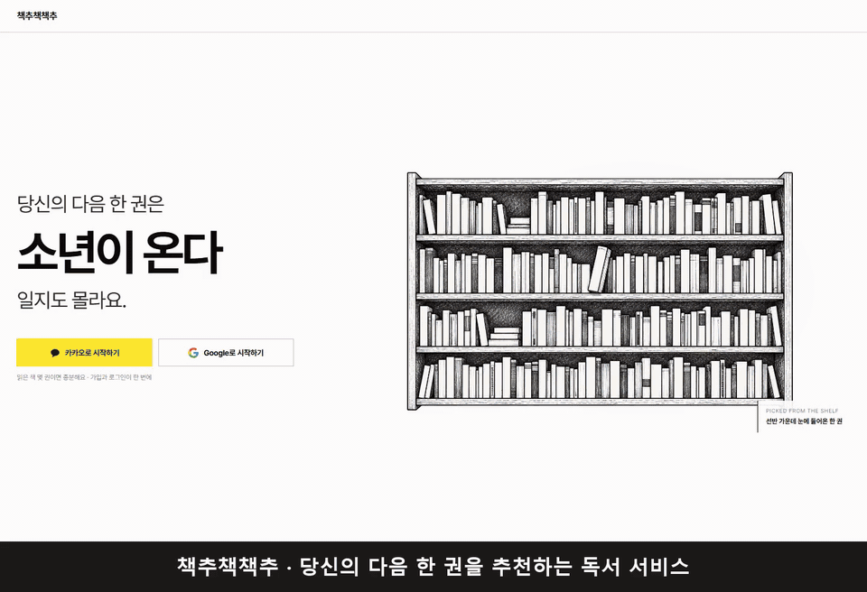</td>
    <td>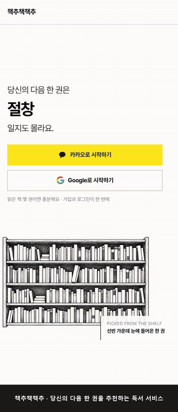</td>
  </tr>
</table>

카카오나 Google로 시작해 닉네임·생년월일·성별, 관심 분야를 고르고, 내 세대 인기 도서 중 읽은 책에 별점을 매기면 홈으로 들어갑니다. 여기서 입력한 정보가 첫 추천의 출발점이 됩니다.

**내 담당**: 카카오·Google OAuth 로그인, 리프레시 토큰으로 로그인을 유지하는 세션, 온보딩 API

## 2. 세대별 인기도서 홈

<table>
  <tr><th>웹</th><th>모바일</th></tr>
  <tr>
    <td>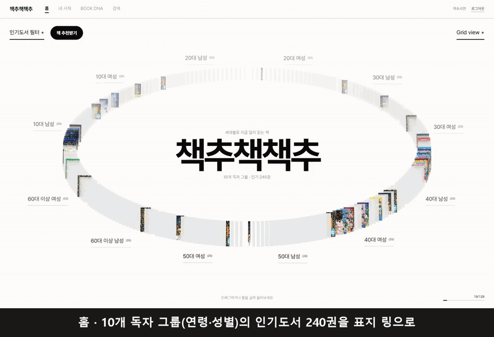</td>
    <td>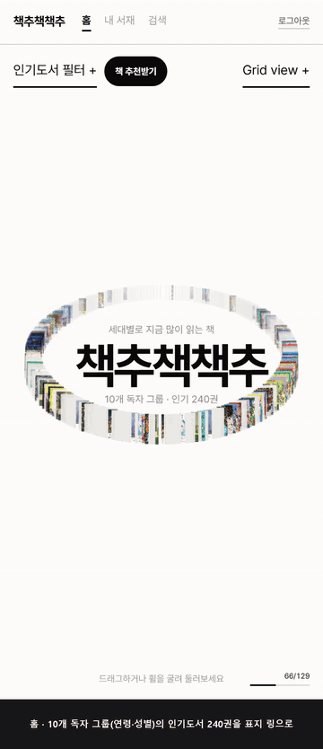</td>
  </tr>
</table>

10개 독자 그룹의 인기 도서 240권이 표지 링으로 돌아가고, 연령·성별 필터로 그룹을 바꿀 수 있습니다. 표지를 누르면 그룹 내 순위와 최근 3개월 대출 수가 보이고, 도서 상세로 이어집니다.

**내 담당**: 도서관 대출 데이터를 바탕으로 한 인기·연령대별 인기 도서 API

## 3. 도서 검색과 완독 기록

<table>
  <tr><th>웹</th><th>모바일</th></tr>
  <tr>
    <td>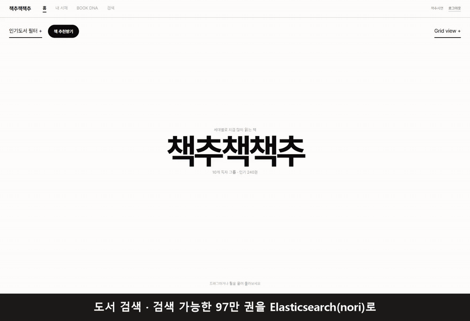</td>
    <td>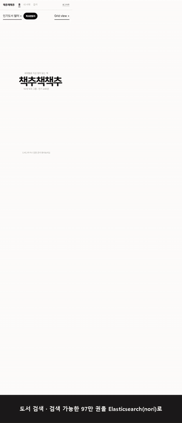</td>
  </tr>
</table>

띄어쓰기 없이 "총균쇠"라고 검색해도 「총 균 쇠」를 찾습니다. 도서 상세에서는 도서관 대출 지표, 책 소개, 비슷한 책, 함께 대출된 책을 보고, 읽었어요를 눌러 완독일·별점·한 줄 감상을 남깁니다.

**내 담당**: 검색에 보여 줄 책을 정하는 데이터 정책, 도서 상세·함께 대출된 책·비슷한 책 API

## 4. 오늘의 책추 추천

<table>
  <tr><th>웹</th><th>모바일</th></tr>
  <tr>
    <td>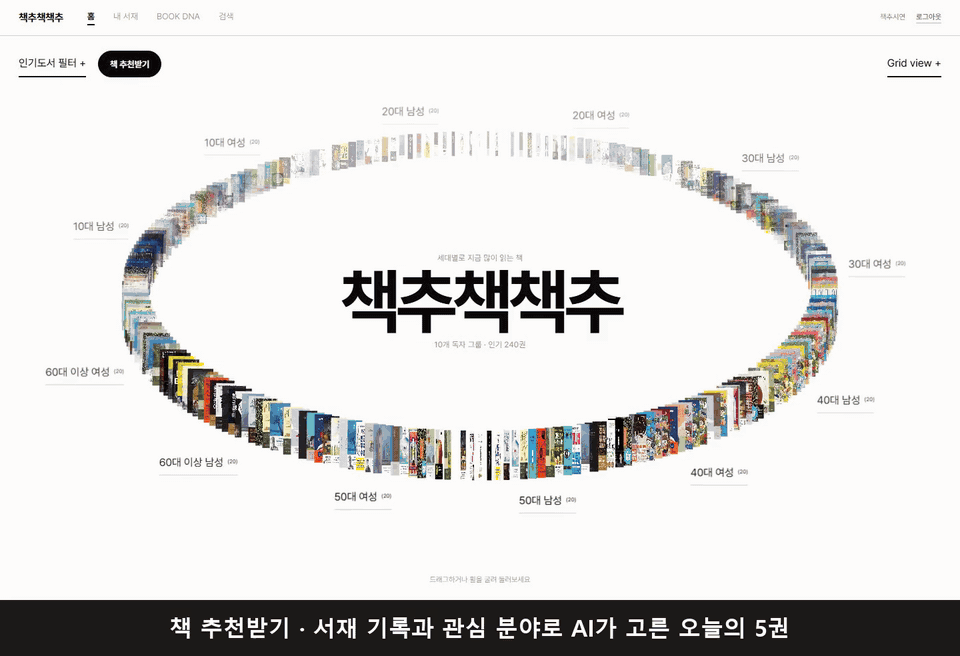</td>
    <td>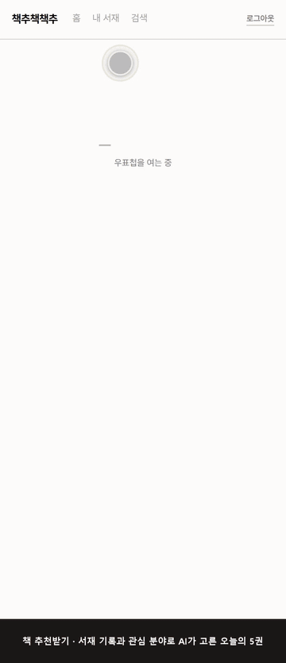</td>
  </tr>
</table>

AI가 고른 추천 5권이 우표첩처럼 놓이고, 엽서에 추천 이유가 적혀 나옵니다. 다른 후보를 꺼내 보거나 다시 추천받을 수 있고, 관심 태그를 골라 추천 방향을 바꿀 수 있습니다.

**내 담당**: 추천 후보 40.6만 권을 정하는 기준, 추천 요청과 결과를 기록하는 행동 이벤트 API

## 5. 내 서재

<table>
  <tr><th>웹</th><th>모바일</th></tr>
  <tr>
    <td>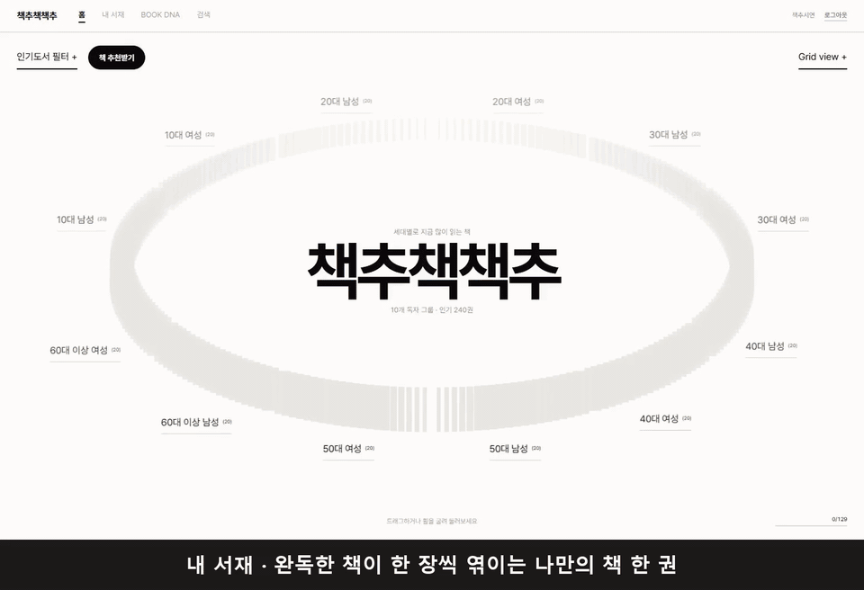</td>
    <td>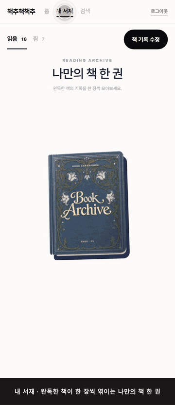</td>
  </tr>
</table>

완독 기록이 한 권의 책처럼 엮여 독서 통계와 목차, 책별 기록으로 이어집니다. 월별 완독 연표에서 표지를 누르면 해당 기록으로 바로 넘어가고, 찜한 책은 선반에 꽂혀 보입니다.

## 6. BOOK DNA

<table>
  <tr><th>웹</th><th>모바일</th></tr>
  <tr>
    <td>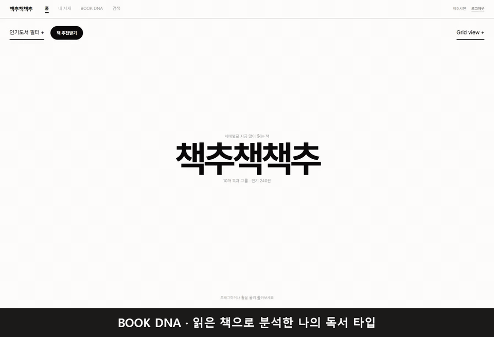</td>
    <td>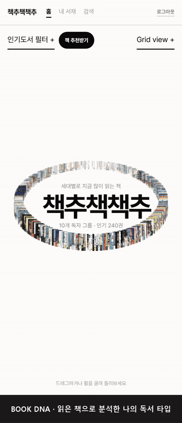</td>
  </tr>
</table>

서재 기록을 바탕으로 독서 타입과 5개 지표, 취향의 지도, 월별 완독과 별점 습관 같은 독서 습관을 보여 줍니다.

---

[← README로 돌아가기](README.md) · [개선 상세 보기](docs/개선_상세.md)
